# Project 01 – AWS EC2 Web Server Deployment

## Project Overview

This project demonstrates how to deploy a publicly accessible web server using Amazon EC2 and Apache HTTP Server on Amazon Linux 2023.

The objective was to launch and configure an EC2 instance, install Apache, host a custom HTML webpage, and verify public HTTP connectivity.

## Architecture

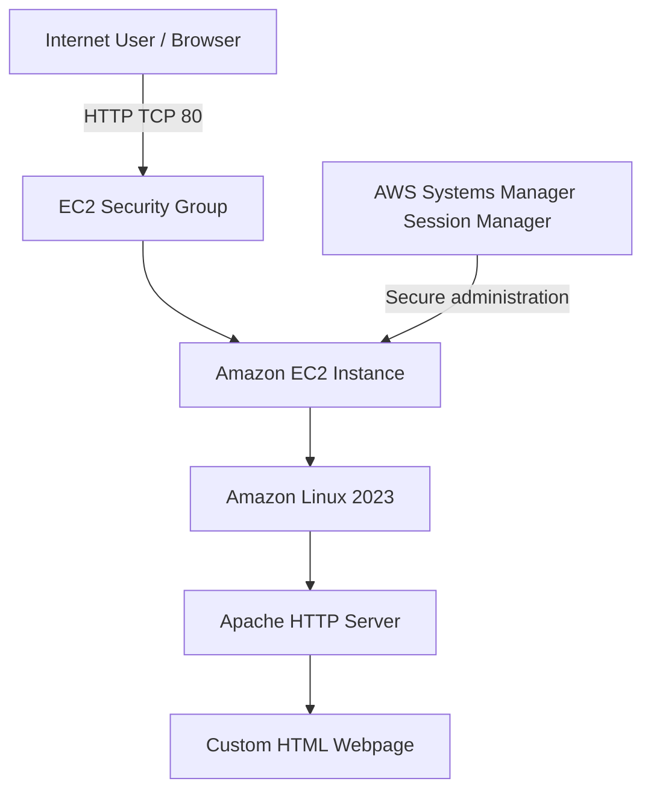

## AWS Services and Technologies Used

- Amazon EC2 – Virtual server hosting
- Amazon EBS – Root storage volume
- AWS IAM – EC2 instance permissions
- AWS Systems Manager – Remote server administration
- Security Groups – Network traffic control
- Amazon Linux 2023 – Operating system
- Apache HTTP Server – Web server
- HTML and CSS – Website development
- Linux commands – Server administration

## Implementation Steps

### 1. EC2 Instance Configuration

- Reused an existing EC2 instance.
- Instance type: t3.micro
- Operating system: Amazon Linux 2023
- Region: Asia Pacific (Mumbai), ap-south-1
- Root EBS volume: 8 GiB

### 2. Security Group Configuration

Configured inbound HTTP access:

| Type | Protocol | Port | Source |
|---|---|---|---|
| HTTP | TCP | 80 | 0.0.0.0/0 |

Used AWS Systems Manager Session Manager for server administration instead of SSH.

### 3. Connect to EC2 Using Session Manager

Connected successfully and verified the environment:

```bash
whoami
cat /etc/os-release
uname -r
```

### 4. Install Apache Web Server

```bash
sudo dnf install -y httpd
```

Verified the installation:

```bash
httpd -v
```

### 5. Start and Enable Apache

```bash
sudo systemctl start httpd
sudo systemctl enable httpd
sudo systemctl status httpd
```

### 6. Create the Website

Created a custom HTML webpage:

```bash
sudo tee /var/www/html/index.html > /dev/null <<'EOF'
```

The webpage displays the project name, operating system, web server and AWS region.

### 7. Verify Website Locally

```bash
curl http://localhost
curl -I http://localhost
```

Expected HTTP response:

```text
HTTP/1.1 200 OK
Server: Apache/2.4.68 (Amazon Linux)
Content-Type: text/html; charset=UTF-8
```

### 8. Verify Public Website Access

Opened the EC2 public IPv4 address in a browser using HTTP.

Successfully displayed the custom webpage from the internet.

## Troubleshooting and Challenges

### Issue 1: Apache Failed to Start

Error:

```text
AH00072: make_sock: could not bind to address 0.0.0.0:80
Address already in use
```

**Root Cause:** Nginx was already running and occupying TCP port 80.

**Investigation:**

```bash
sudo ss -ltnp | grep ':80'
ps aux | grep nginx
```

**Resolution:**

```bash
sudo systemctl stop nginx
sudo systemctl disable nginx
sudo systemctl start httpd
sudo systemctl enable httpd
```

Apache started successfully after Nginx was stopped.

### Issue 2: Command Typing Error

Initially entered `sytemctl` instead of `systemctl`. Corrected the spelling and successfully enabled Apache.

## Final Verification Results

| Verification | Result |
|---|---|
| EC2 instance | Running during testing |
| Session Manager | Successful |
| Apache installation | Successful |
| Apache service | Active |
| Apache auto-start | Enabled |
| HTTP response | 200 OK |
| Local website access | Successful |
| Public website access | Successful |

## Screenshots and Evidence

### EC2 Instance and Connection

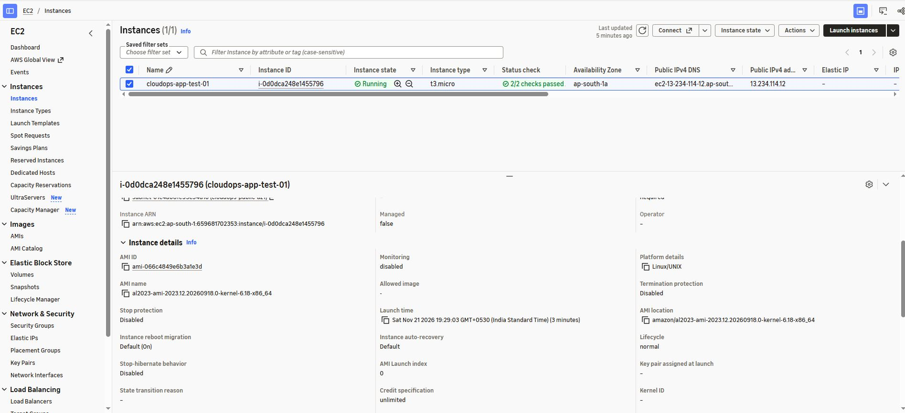

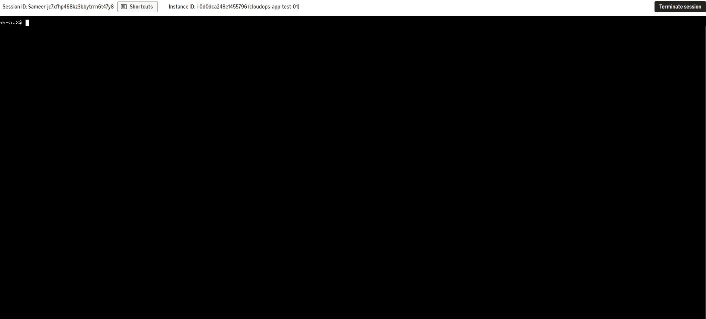

### Apache Installation and Troubleshooting

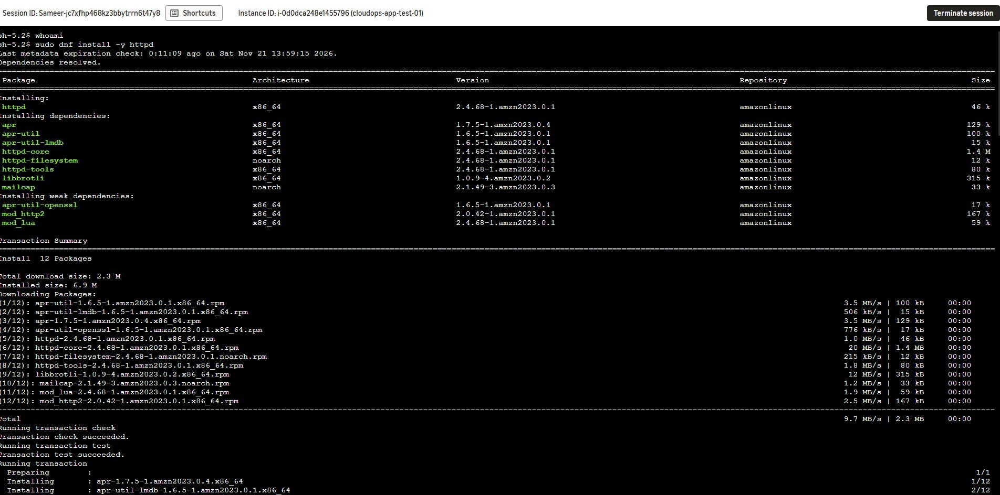

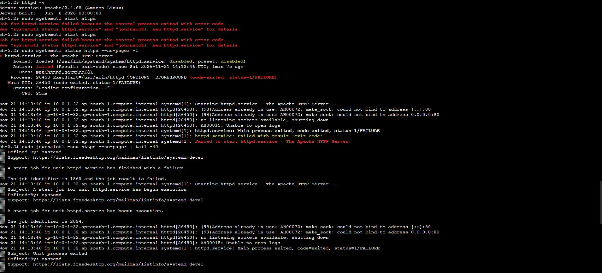

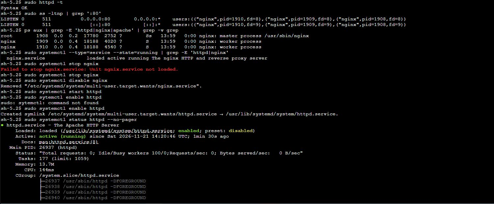

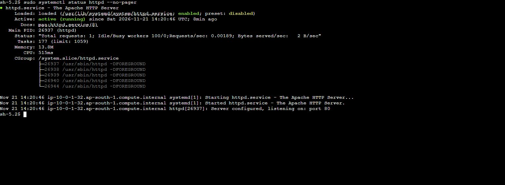

### Website Deployment and Testing

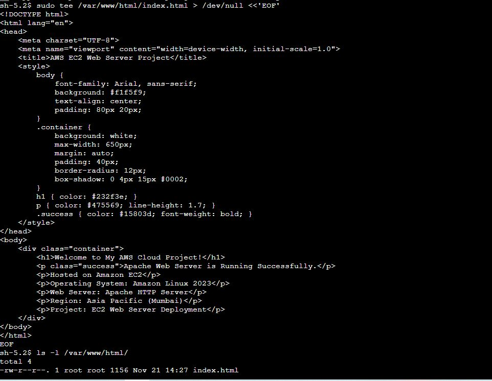

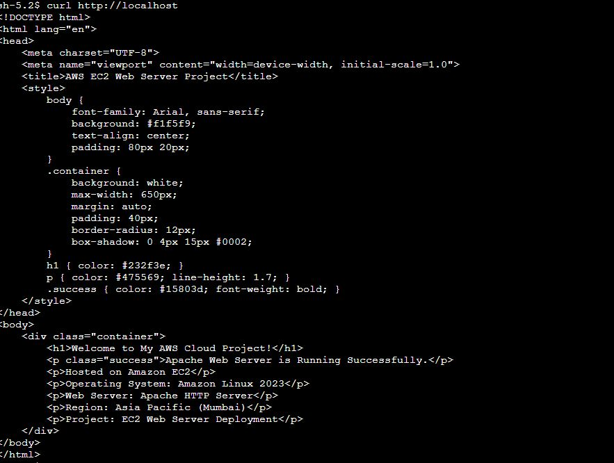

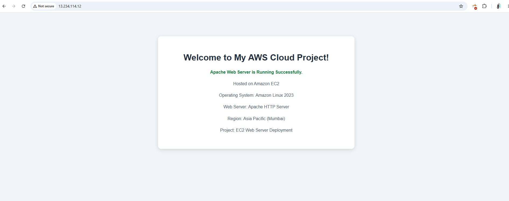

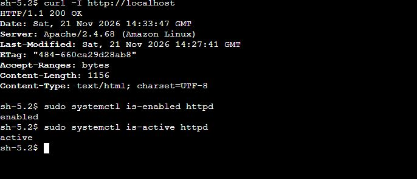

## Key Learning Outcomes

- Launching and managing Amazon EC2 instances.
- Connecting to Linux servers through AWS Systems Manager.
- Installing and managing Apache using systemctl.
- Configuring security group inbound rules.
- Hosting a custom HTML webpage.
- Testing HTTP connectivity using curl.
- Troubleshooting Linux web server port conflicts.
- Understanding the difference between Nginx and Apache services.

## Future Improvements

- Configure HTTPS using SSL/TLS.
- Implement CloudWatch monitoring and alarms.
- Improve security group restrictions.
- Enable EBS encryption.
- Automate deployment using user data.

## Author

**AWS Cloud Portfolio – Hands-on Project 01**

GitHub: https://github.com/samkr321

*This project was completed as part of my practical AWS cloud learning and career transition into Cloud Support and Cloud Operations.*
