# AWS S3 Secure Storage with IAM Role-Based Access

## Project Overview

Implemented a secure AWS S3 storage solution using IAM role-based access from an Amazon EC2 instance. The project demonstrates secure file operations between EC2 and S3 without storing AWS access keys on the EC2 instance.

## AWS Services Used

- Amazon S3
- AWS IAM
- Amazon EC2
- AWS Systems Manager (Session Manager)
- AWS CLI

## Implementation

1. Created a private S3 bucket.
2. Configured S3 Block Public Access.
3. Created a custom IAM policy with required S3 permissions.
4. Attached the policy to an EC2 IAM role.
5. Connected to EC2 using Systems Manager Session Manager.
6. Uploaded a file from EC2 to S3 using AWS CLI.
7. Downloaded the file from S3 to EC2.
8. Verified IAM permissions and Linux filesystem permissions.

## IAM Security

Implemented role-based access using an EC2 IAM role and a custom least-privilege policy.

Permissions used for the file operations:

- `s3:ListBucket`
- `s3:GetObject`
- `s3:PutObject`

No long-term AWS access keys were stored on the EC2 instance.

## Testing and Verification

- Successfully uploaded an object to S3.
- Successfully downloaded the object from S3.
- Verified downloaded file contents.
- Troubleshot IAM AccessDenied and Linux filesystem permission errors.

## Troubleshooting & Challenges

1. Resolved IAM `s3:PutObject` AccessDenied errors by correcting the IAM policy.
2. Resolved Linux `/home` directory permission issues during file download.

## Key Learnings

- S3 bucket security and Block Public Access.
- IAM policies, roles, and instance profiles.
- Secure EC2-to-S3 communication.
- AWS CLI operations.
- Linux filesystem permissions.
- AWS troubleshooting and access control.

## Screenshots

### 1. S3 Bucket Creation
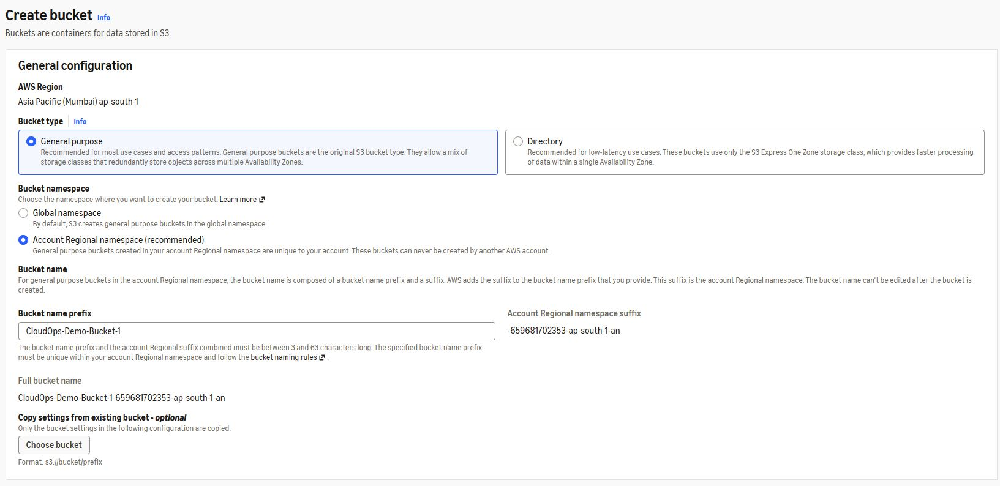

### 2. S3 Encryption
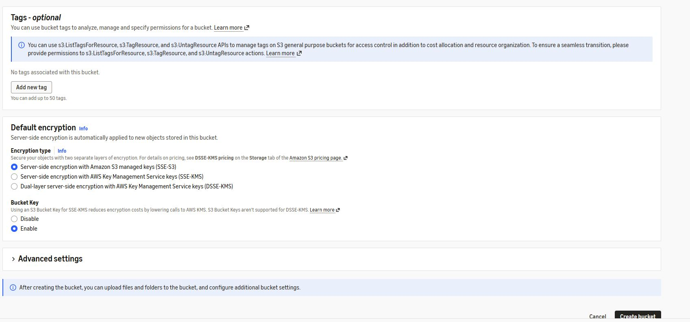

### 3. S3 Bucket Security
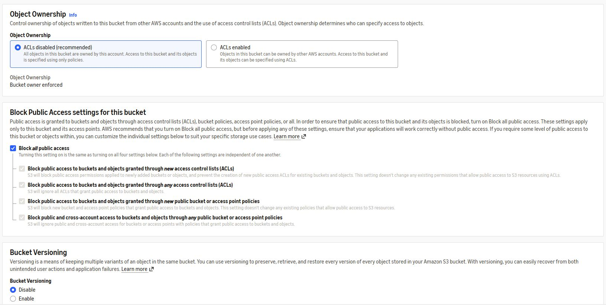

### 4. IAM Policy Creation
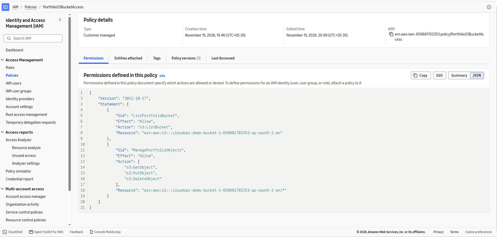

### 5. IAM Policy Attachment
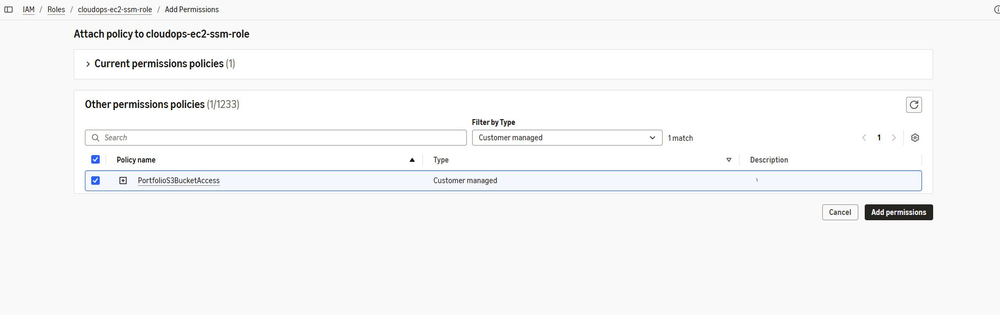

### 6. IAM Policy Verification
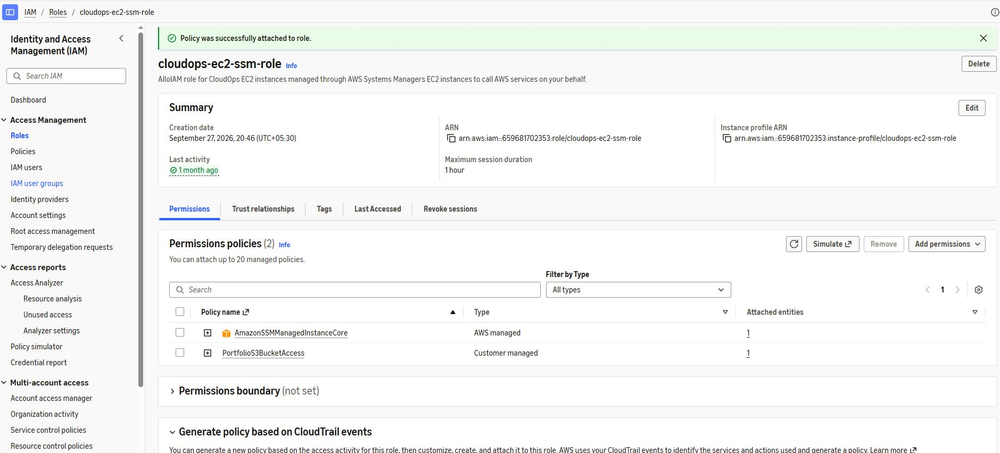

### 7. EC2 SSM Connection
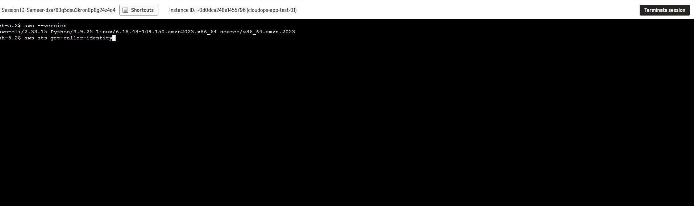

### 8. S3 File Upload
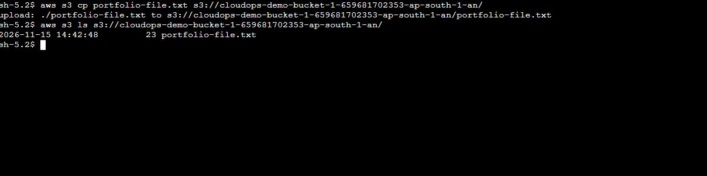

### 9. S3 File Download
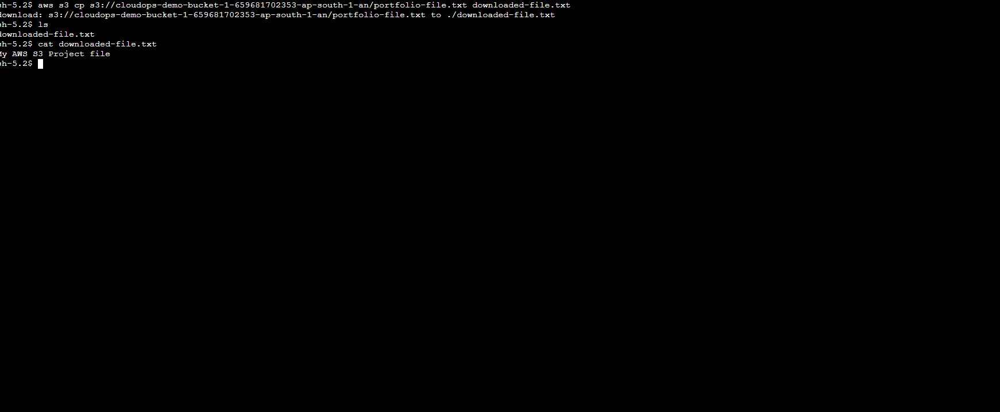

### 10. File Verification
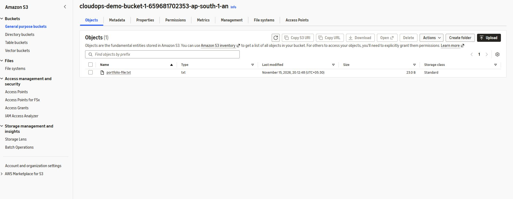

## AWS Architecture Diagram

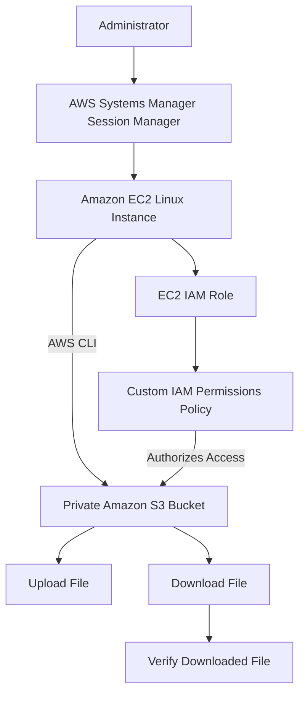

## Project Outcome

Successfully implemented and tested secure EC2-to-S3 file operations using IAM role-based access, AWS CLI, and Systems Manager Session Manager.
