# Project 03 – AWS CloudWatch Monitoring & SNS Email Alerts

## Project Overview

This project demonstrates how to monitor an Amazon EC2 instance using **Amazon CloudWatch** and configure automated email notifications using **Amazon SNS (Simple Notification Service)**.

A CloudWatch alarm monitors EC2 CPU utilization and sends an email notification when CPU usage exceeds the configured threshold of 70%.

The project also demonstrates how to generate CPU load, trigger an alarm, receive an email notification, and verify that the alarm returns to the OK state after CPU utilization decreases.

## AWS Services Used

- **Amazon EC2:** Hosted the test Linux instance.
- **Amazon CloudWatch:** Collected and monitored EC2 CPU utilization metrics.
- **CloudWatch Alarms:** Detected CPU utilization exceeding the configured threshold.
- **Amazon SNS:** Delivered alarm notifications through email.
- **AWS Systems Manager Session Manager:** Provided secure terminal access without SSH.

## Environment Details

| Configuration | Value |
|---|---|
| AWS Region | Asia Pacific (Mumbai) – ap-south-1 |
| EC2 Instance Name | cloudops-app-test-01 |
| Instance Type | t3.micro |
| Operating System | Amazon Linux 2023 |
| Monitoring Metric | CPUUtilization |
| Metric Namespace | AWS/EC2 |
| Metric Statistic | Average |
| Monitoring Period | 5 minutes |
| Alarm Threshold | Greater than 70% |
| Evaluation | 1 datapoint within 5 minutes |
| CloudWatch Alarm | cloudops-ec2-high-cpu-alarm |
| SNS Topic | cloudops-ec2-cpu-alerts |
| Notification Protocol | Email |

## Architecture

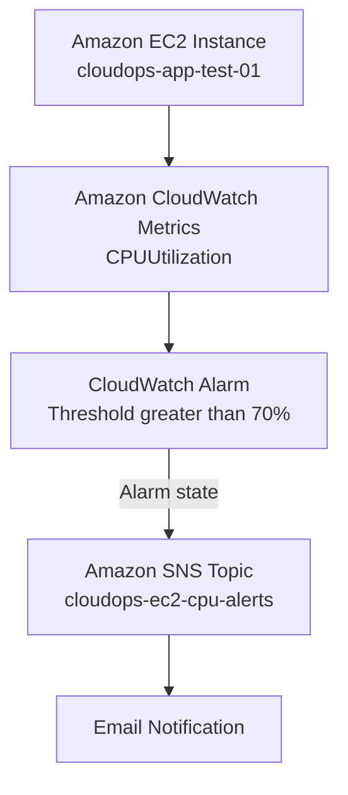

## Implementation Steps

### 1. Started the EC2 Instance

Started the existing EC2 instance named `cloudops-app-test-01` in the Mumbai region and waited for both instance status checks to pass.

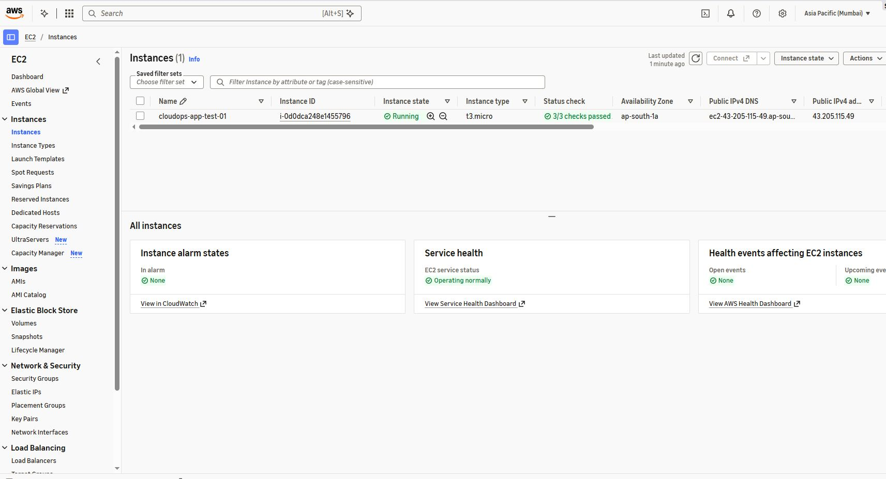

### 2. Verified CloudWatch CPU Metrics

Navigated to CloudWatch → Metrics → EC2 → Per-Instance Metrics and located the CPUUtilization metric for the EC2 instance.

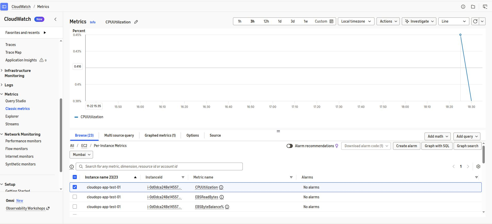

### 3. Configured the CloudWatch Alarm

Created a metric alarm using the following configuration:

- Namespace: AWS/EC2
- Metric: CPUUtilization
- Statistic: Average
- Period: 5 minutes
- Condition: Greater than 70%
- Evaluation: 1 out of 1 datapoints

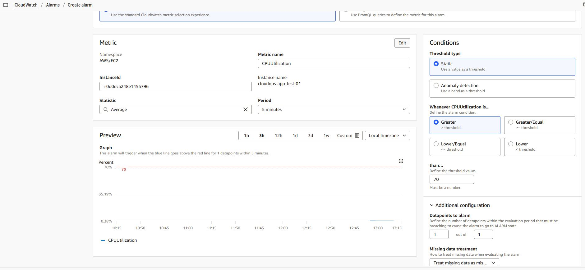

### 4. Added Alarm Details

Configured the alarm name and description.

**Alarm Name:** `cloudops-ec2-high-cpu-alarm`

**Description:** Monitors EC2 CPU utilization and sends an SNS email notification when average CPU exceeds 70%.

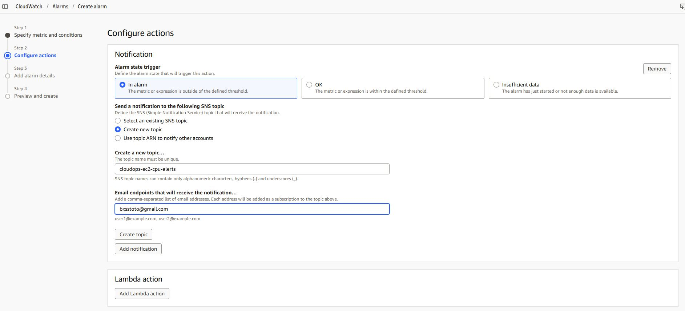

### 5. Created the CloudWatch Alarm

Successfully created the CloudWatch alarm and verified that it appeared in the CloudWatch Alarms dashboard.

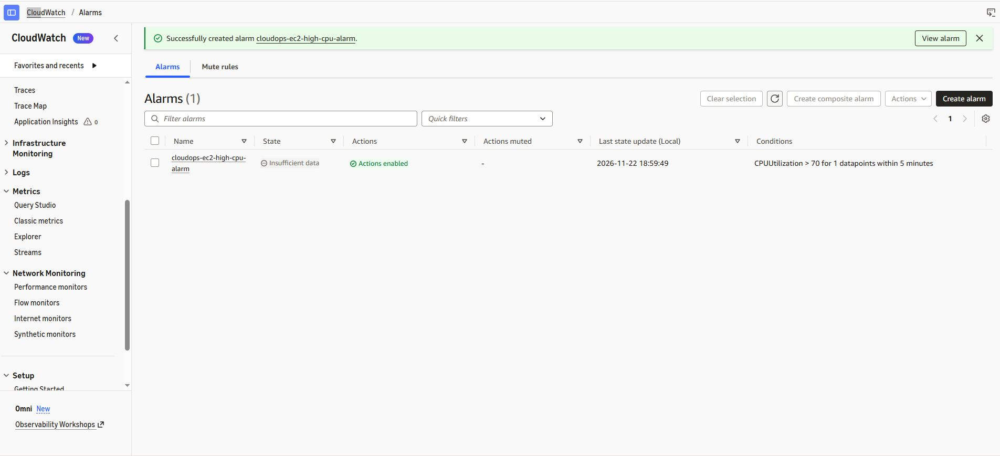

### 6. Created an SNS Topic

Created an Amazon SNS Standard topic named `cloudops-ec2-cpu-alerts` and configured an email subscription.

The email subscription was confirmed successfully.

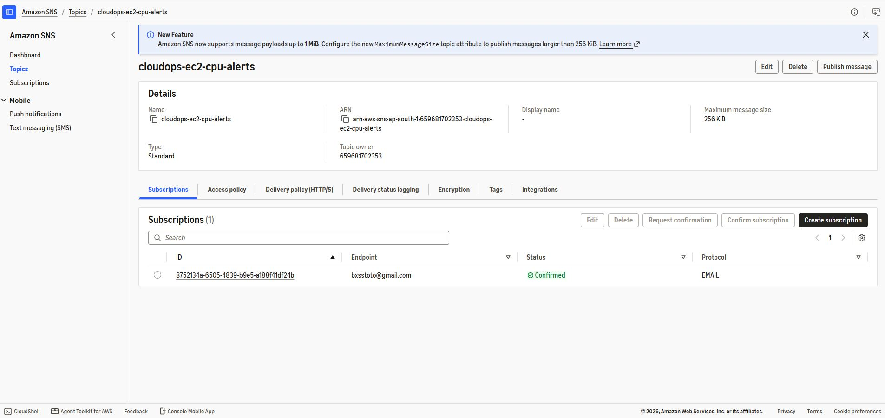

### 7. Generated CPU Load

Connected to the EC2 instance using AWS Systems Manager Session Manager.

Used the following command to generate CPU load:

```bash
yes > /dev/null &
```

Checked CPU utilization using:

```bash
top -bn1 | head -15
```

The `yes` process consumed CPU resources and helped simulate high CPU utilization.

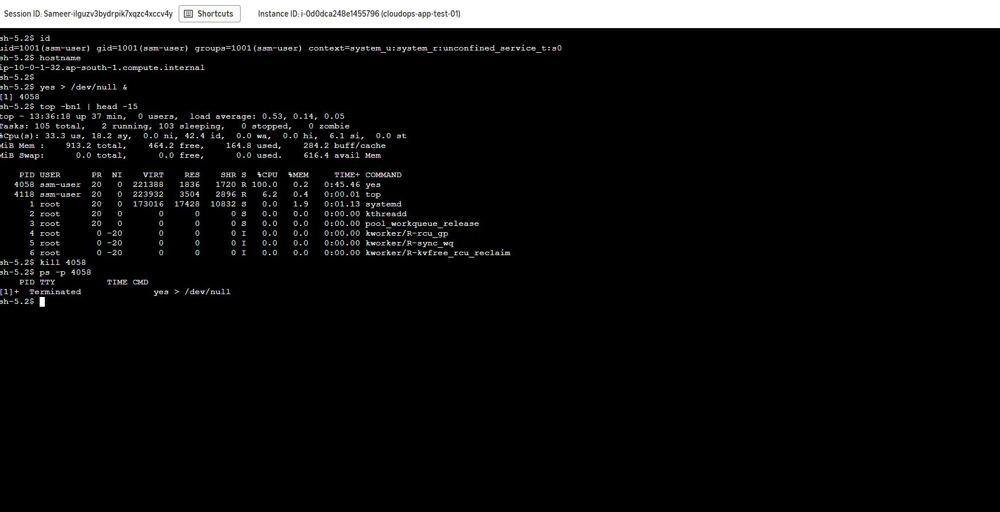

### 8. Monitored CPU Utilization

Observed the CPUUtilization metric in CloudWatch and verified the change in CPU utilization during the load test.

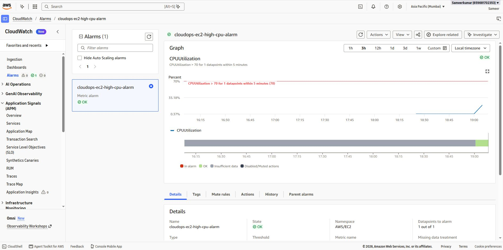

### 9. Stopped the CPU Load Process

After testing, stopped the background CPU load process using its process ID.

```bash
kill 4058
```

Verified that the process had stopped:

```bash
pgrep -a yes
```

No running `yes` process was returned.

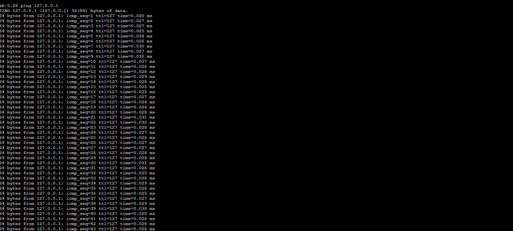

### 10. Verified SNS Email Notification

CloudWatch transitioned the alarm from OK to In alarm, and the SNS notification action was successfully executed.

Received the CPU utilization alert through the configured email subscription.

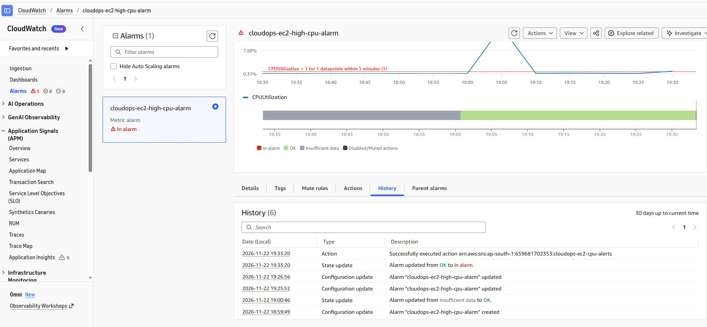

### 11. Verified Alarm Recovery

After stopping the CPU load process, CPU utilization decreased and CloudWatch transitioned the alarm back to the OK state.

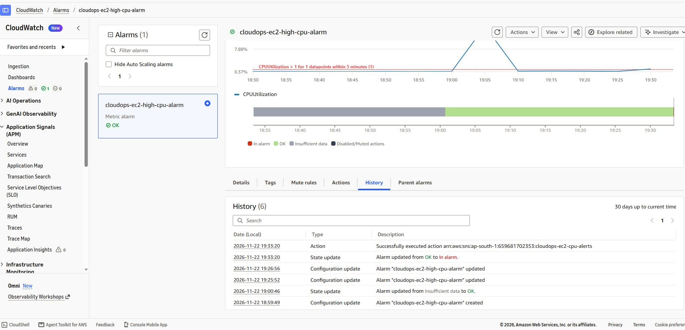

## Final Results

Successfully completed the following tasks:

- Started and monitored an existing EC2 instance.
- Retrieved EC2 CPU utilization metrics through CloudWatch.
- Created a CloudWatch CPU utilization alarm.
- Configured an SNS topic and confirmed an email subscription.
- Generated CPU load to simulate high utilization.
- Successfully triggered the CloudWatch alarm.
- Received an SNS email notification.
- Stopped the CPU load process.
- Verified that the alarm returned to the OK state.

## Key Learnings

Through this project, I gained practical experience with:

- Amazon CloudWatch metrics and monitoring.
- Creating and configuring CloudWatch alarms.
- Understanding alarm states: OK, ALARM, and INSUFFICIENT_DATA.
- Amazon SNS topics and email subscriptions.
- Monitoring EC2 CPU utilization.
- Testing alarm notifications using simulated CPU load.
- Troubleshooting and verifying alarm state transitions.

## Cost Management

To avoid unnecessary AWS charges:

- Stop the EC2 instance when it is not required.
- Remember that attached EBS storage can continue to incur charges while EC2 is stopped.
- Review and delete unused CloudWatch alarms when the project is no longer needed.
- Delete unused SNS topics and subscriptions.

## Conclusion

This project demonstrates a practical AWS monitoring and alerting workflow using Amazon CloudWatch and Amazon SNS.

It helped me understand how cloud administrators can monitor EC2 infrastructure, identify high CPU utilization, and receive automated notifications to respond to potential performance issues.

**Project Status: Completed**
