# Project 04: AWS CLI & Linux Administration

## Project Overview

This project demonstrates practical AWS Cloud Operations and Linux administration skills by managing AWS resources directly from an Amazon EC2 instance using the AWS CLI.

I used AWS Systems Manager (SSM) Session Manager to connect securely to my EC2 instance, verified IAM role-based authentication, performed S3 operations, and practised Linux system administration, service management, process monitoring, and log analysis.

## Objectives

- Connect to an EC2 instance using AWS Systems Manager Session Manager.
- Verify AWS CLI installation and configuration.
- Understand IAM role-based authentication.
- Perform S3 operations using AWS CLI.
- Practise Linux system monitoring and administration.
- Inspect running services, processes, and network ports.
- Verify Apache web server availability.
- Analyse Linux and Apache logs.

## AWS Environment

| Component | Configuration |
|---|---|
| Cloud Provider | Amazon Web Services |
| Region | Asia Pacific (Mumbai) - ap-south-1 |
| Compute Service | Amazon EC2 |
| Instance Type | t3.micro |
| Operating System | Amazon Linux 2023 |
| Access Method | AWS Systems Manager Session Manager |
| AWS CLI | Version 2 |
| IAM Role | cloudops-ec2-ssm-role |
| Storage Service | Amazon S3 |
| Web Server | Apache HTTP Server |
| Monitoring Tools | Linux commands, systemctl, journalctl |

## Architecture

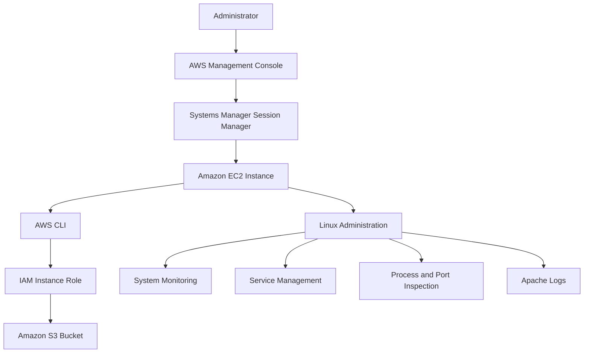

## Step 1: Connect to EC2 Using SSM

Connected to the EC2 instance through AWS Systems Manager Session Manager without using SSH or manually configured SSH keys.

Verified the current user:

```bash
whoami
```

Output:

```text
ssm-user
```

Checked the hostname:

```bash
hostname
```

Checked the operating system:

```bash
cat /etc/os-release
```

**Result:** Successfully connected to the Amazon Linux 2023 EC2 instance.

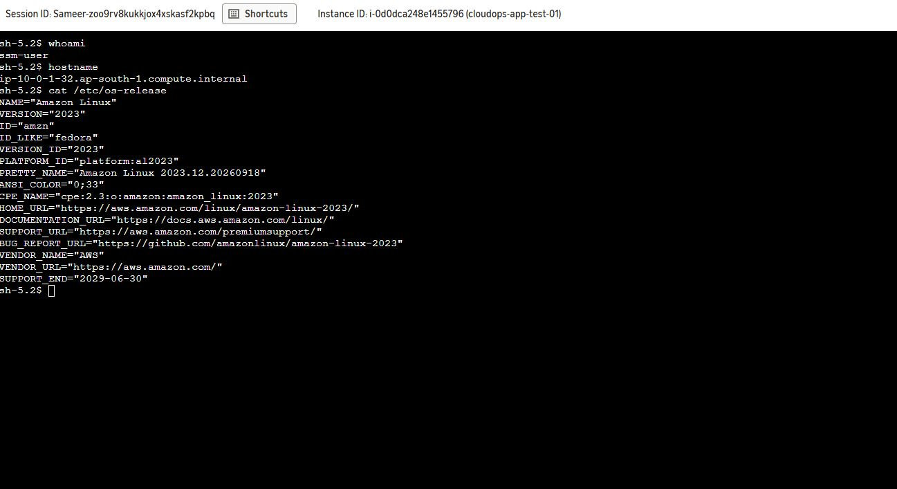

## Step 2: Verify AWS CLI Installation

Checked the AWS CLI version:

```bash
aws --version
```

Verified AWS CLI configuration:

```bash
aws configure list
```

**Result:** AWS CLI version 2 was installed and configured to use the EC2 instance's IAM role credentials. No manually configured access keys were required.

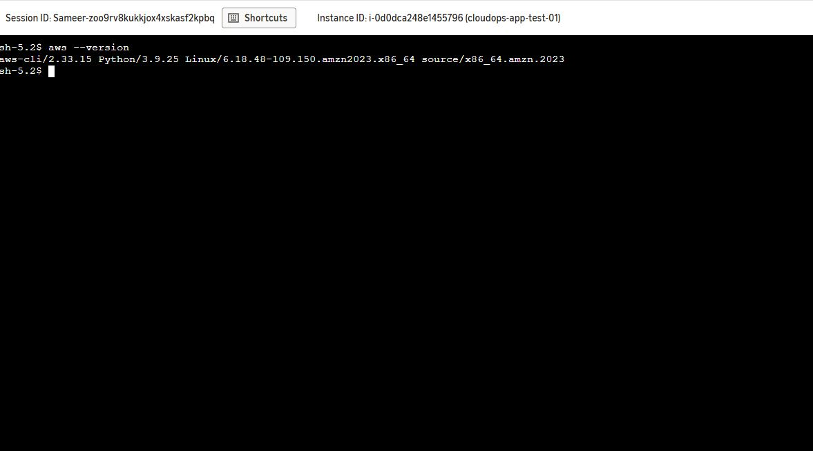

## Step 3: Verify IAM Role-Based Authentication

Executed:

```bash
aws sts get-caller-identity
```

The command returned the AWS account and assumed-role identity.

IAM role used:

```text
cloudops-ec2-ssm-role
```

Verified the credential source:

```bash
aws configure list
```

**Result:** Confirmed that the EC2 instance was using temporary credentials supplied through its attached IAM role.

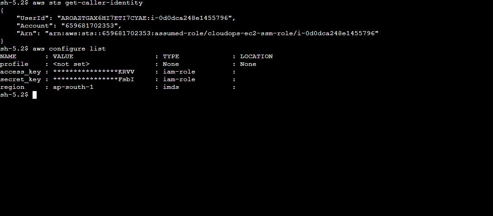

## Step 4: Perform S3 Operations Using AWS CLI

Used AWS CLI to list objects in the existing S3 bucket.

```bash
aws s3 ls s3://cloudops-demo-bucket-1-659681702353-ap-south-1-an
```

Downloaded an existing file:

```bash
aws s3 cp s3://cloudops-demo-bucket-1-659681702353-ap-south-1-an/portfolio-file.txt ./portfolio_file.txt
```

Read the downloaded file:

```bash
cat portfolio_file.txt
```

**Result:** Successfully listed and downloaded an S3 object using IAM role-based permissions.

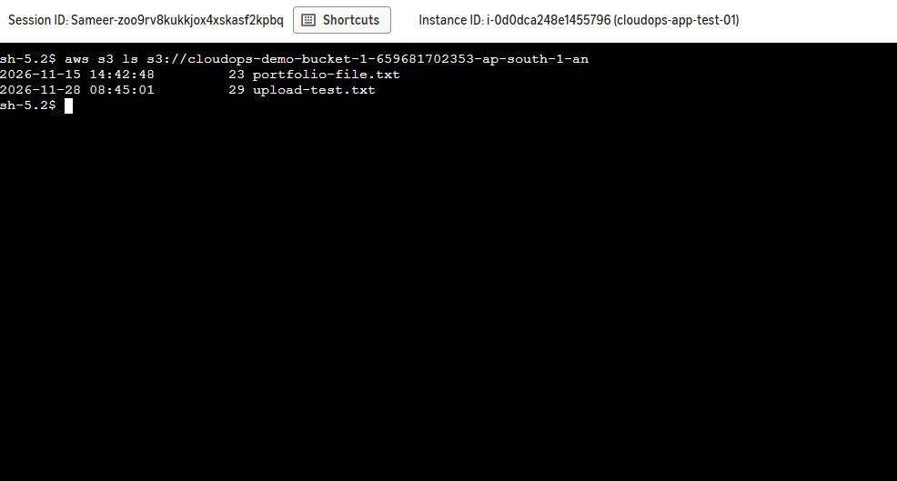

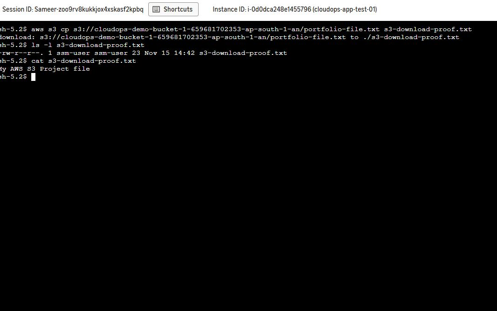

## Step 5: Upload and Download Files Using AWS CLI

Created a test file:

```bash
echo "AWS CLI upload test from EC2" > upload-test.txt
```

Uploaded the file to S3:

```bash
aws s3 cp upload-test.txt s3://cloudops-demo-bucket-1-659681702353-ap-south-1-an/
```

Verified the uploaded object:

```bash
aws s3 ls s3://cloudops-demo-bucket-1-659681702353-ap-south-1-an
```

Downloaded the uploaded object:

```bash
aws s3 cp s3://cloudops-demo-bucket-1-659681702353-ap-south-1-an/upload-test.txt ./downloaded-test.txt
```

Verified its contents:

```bash
cat downloaded-test.txt
```

Output:

```text
AWS CLI upload test from EC2
```

**Result:** Successfully completed S3 upload, download, and verification operations.

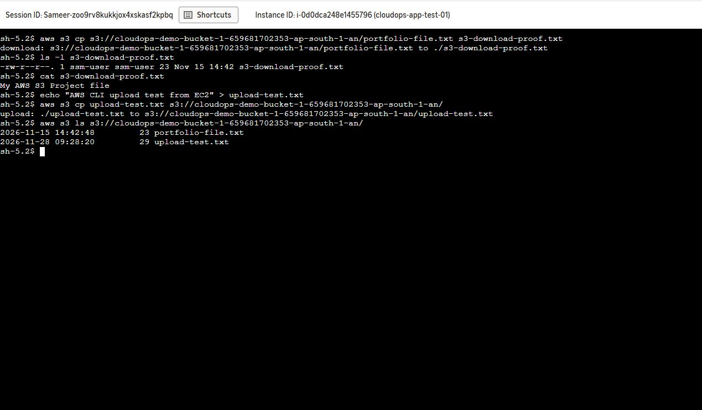

## Step 6: Linux System Monitoring

Practised Linux commands to monitor system health and resource utilisation.

### Check current date and time

```bash
date
```

### Check system uptime and load average

```bash
uptime
```

### Check memory utilisation

```bash
free -h
```

### Check disk utilisation

```bash
df -h
```

### Monitor CPU and running processes

```bash
top -bn1 | head -15
```

**Result:** Checked CPU utilisation, memory usage, disk space, system uptime, and running processes.

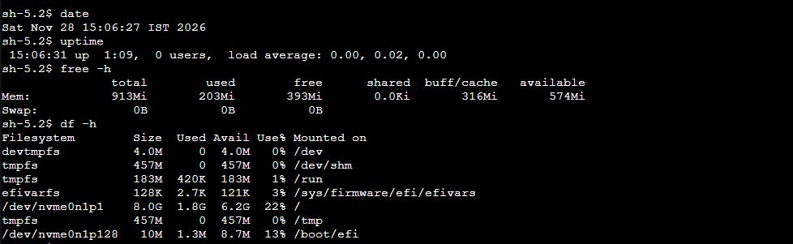

## Step 7: Linux Service Management

Used systemctl to inspect and manage Linux services.

Checked Apache service status:

```bash
sudo systemctl status httpd --no-pager
```

Checked whether Apache starts automatically:

```bash
sudo systemctl is-enabled httpd
```

Checked whether Apache was running:

```bash
sudo systemctl is-active httpd
```

Listed currently running services:

```bash
systemctl list-units --type=service --state=running --no-pager
```

**Result:** Confirmed that Apache HTTP Server and the Amazon SSM Agent were running successfully.

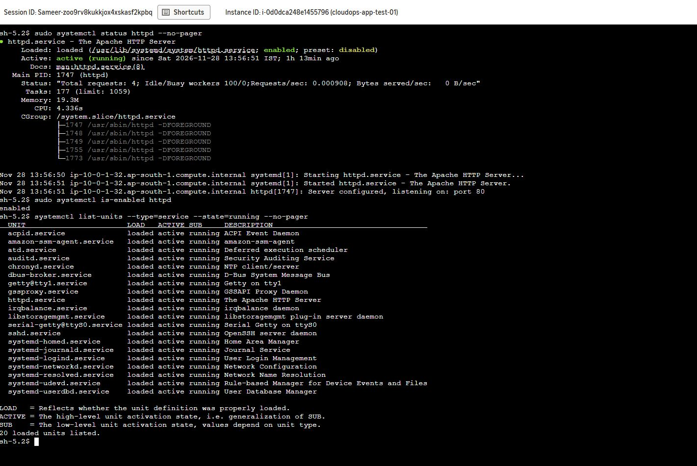

## Step 8: Process and Network Port Inspection

Used Linux commands to inspect running Apache processes:

```bash
ps aux | grep httpd
```

Checked which process was listening on port 80:

```bash
sudo ss -tulpn | grep ':80'
```

**Result:** Identified Apache processes and confirmed that the HTTP service was listening on TCP port 80.

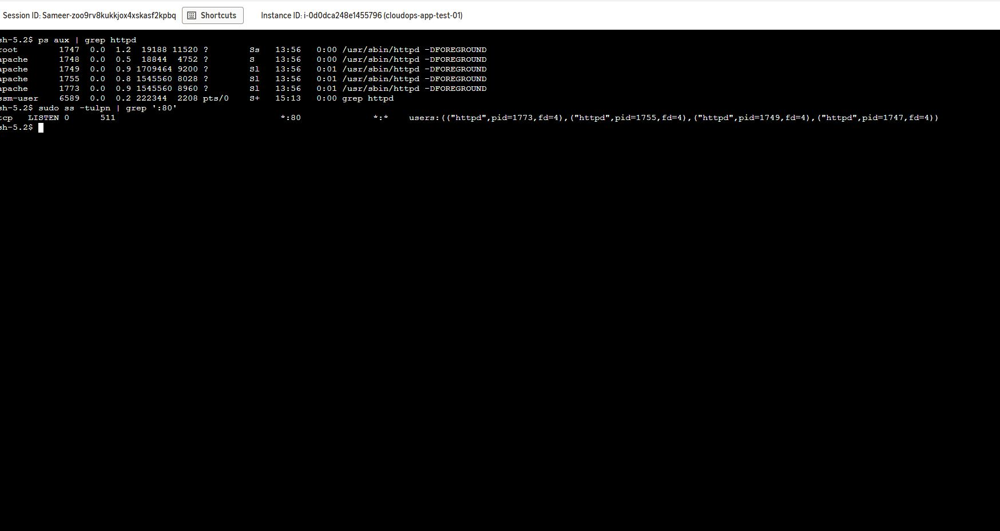

## Step 9: Verify HTTP Response

Tested the Apache web server locally:

```bash
curl -I http://localhost
```

Expected successful response:

```text
HTTP/1.1 200 OK
Server: Apache/2.4.68 (Amazon Linux)
```

**Result:** Confirmed that the Apache web server was responding successfully with HTTP 200 OK.

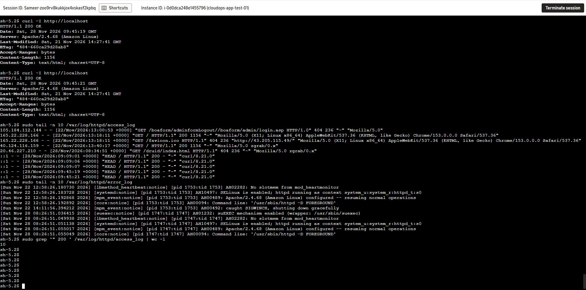

## Step 10: Apache Log Analysis

Inspected recent Apache access log entries:

```bash
sudo tail -n 10 /var/log/httpd/access_log
```

Counted the total access log entries:

```bash
sudo wc -l /var/log/httpd/access_log
```

Counted successful HTTP 200 responses:

```bash
sudo grep '" 200 ' /var/log/httpd/access_log | wc -l
```

Checked recent Apache service logs:

```bash
sudo journalctl -u httpd -n 10 --no-pager
```

Checked recent system errors:

```bash
sudo journalctl -p err -n 15 --no-pager
```

**Result:** Analysed Apache access logs, HTTP response codes, service events, and system error messages. Observed automated internet scanning requests in the access log, including unsuccessful requests. These entries alone do not establish that the instance was compromised.


## Troubleshooting and Learning

During this project, I practised identifying and resolving common operational issues:

- Verified AWS CLI authentication through the EC2 IAM role.
- Identified Linux file ownership and permission issues.
- Used `sudo` when administrative permissions were required.
- Checked running services using `systemctl`.
- Inspected processes using `ps` and `top`.
- Identified the process listening on HTTP port 80 using `ss`.
- Used `curl` to verify web server responses.
- Analysed Apache access logs and system journal entries.

## Skills Demonstrated

- Amazon EC2
- AWS Systems Manager Session Manager
- AWS CLI
- IAM Roles and Temporary Credentials
- Amazon S3
- Linux Administration
- Linux System Monitoring
- Service Management with systemctl
- Process Management
- Network Port Inspection
- Apache HTTP Server
- Log Analysis and Troubleshooting

## Project Outcome

Successfully completed a practical AWS Cloud Operations and Linux Administration exercise.

This project strengthened my understanding of how cloud support and operations engineers use AWS CLI, IAM roles, Linux commands, system services, and application logs to manage
